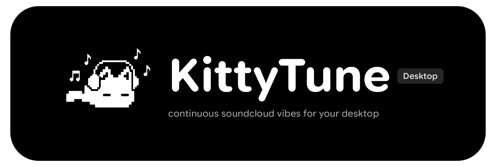
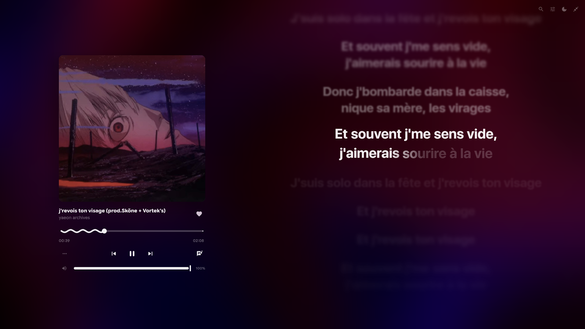
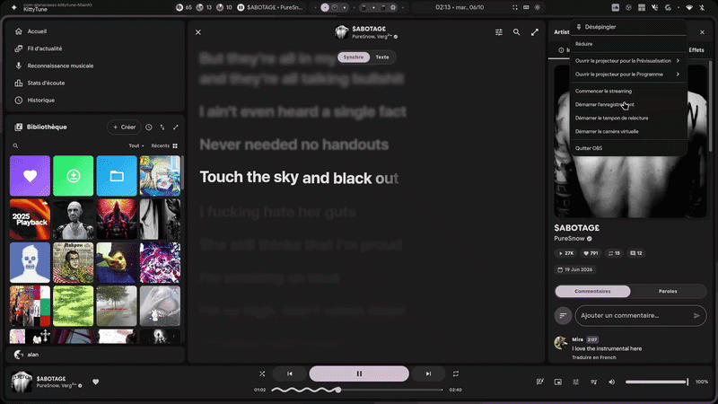
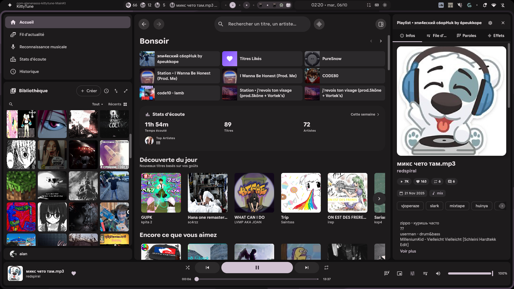

<p align="center">
  <a href="https://alan7383.github.io/kittytune-website/download" title="Download KittyTune"></a>
</p>

<p align="center">
  
</p>
<p align="center">
  <a href="https://alan7383.github.io/kittytune-website/download" title="Download KittyTune"></a>
</p>

<p align="center">
  <sub>KittyTune Desktop is in active beta. Found a bug? <a href="https://github.com/alan7383/KittyTuneDesktop/issues">Open an issue</a>.</sub><br/>
  <sub>Looking for Android? KittyTune is also available on <a href="https://github.com/alan7383/kittytune">Android</a>.</sub>
</p>

> [!NOTE]
> KittyTune Desktop is developed and tested primarily on Linux. Builds for Windows and macOS are experimental. If you hit bugs or rough edges on Windows or macOS, please report them in an issue or submit a pull request.

## About

KittyTune Desktop is a native desktop music player built with Kotlin and Compose Multiplatform, running directly on the JVM with zero Electron overhead.

KittyTune Desktop is a native desktop music player by [alan7383](https://github.com/alan7383/KittyTuneDesktop), written in Kotlin with Compose Multiplatform and Material 3 Expressive, aimed mainly at Linux. It runs on the JVM, with no Electron or web wrapper.

It streams from **SoundCloud** and syncs your likes, reposts and playlists. When a better source has the track, it can switch to **Qobuz** (Hi-Res Lossless), **TIDAL** (FLAC), **Deezer** or **YouTube Music**. It also shows live karaoke-style lyrics, crossfades tracks with DJ Automix, and includes an audio DSP rack with 30+ effects.

> [!IMPORTANT]
> **This is a personal fork** of the upstream project, kept in sync with it. Everything above is upstream's work; the section below lists what this fork adds.

### + what this fork adds

- **YouTube Music account**: sign in with Google (OAuth device flow, in your default browser), two-way sync of likes and artists, and import of your listening history.
- **Faster playback start**: InnerTube fast path for YouTube with current ANDROID/IOS clients, and a parallel race between providers so the first stream that resolves wins.
- **Pixel theme**: pixel font, pixel icons and pixel-style switches, toggled from the Themes settings.
- **Tray fix** for Wayland/Hyprland (DBusMenu support) and media controls.
- **Italian translation** and language option.
- **In-app updates from this fork's releases**, with an automated workflow that merges upstream releases and publishes builds with the upstream changelog.
- Tracks played from inside playlists are now recorded in history.

---

### * features

<details open>
<summary><b>~ soundcloud-first streaming & account sync</b></summary>

* **full soundcloud account sync**: link your account to sync liked tracks, playlists, reposts, and history in real time.
* **true full-playlist shuffle**: shuffles your entire library or playlist at once — no lazy-load limits or repeated tracks.
* **zero ads & continuous vibes**: pure audio streaming without banner, audio, or video ads.
* **search & discovery**: instant search across tracks, artists, albums, and playlists with instant filters.
* **history & listening stats**: local playback history, play counts, and listening statistics persistence.
</details>

<details>
<summary><b>> lossless upgrades & multi-provider engine</b></summary>

* **smart isrc resolver**: automatically resolves tracks to high-fidelity studio sources.
* **multi-source priority**: customize streaming order between Qobuz (Hi-Res Lossless), TIDAL (FLAC), Deezer (HQ), YouTube Music, and SoundCloud.
* **automatic fallback**: seamlessly switches to alternative providers if a track is unavailable or region-locked.
</details>

<details>
<summary><b>+ synchronized lyrics & apple-style karaoke</b></summary>

* **real-time synchronized lyrics**: syllable-level and word-by-word karaoke tracking powered by LrcLib and KuGou scrapers.
* **duet singer detection**: automatically identifies multi-artist tracks and displays lyrics split to the left and right sides.
* **variable font tuning**: customize font weight, width, slant, roundness, optical size, and grade for lyrics typography.
* **accompanist animations**: smooth spring rebound animations, blur transitions, and per-track manual sync offset persistence.
</details>

<details>
<summary><b># dj automix & 30+ audio fx studio</b></summary>

* **automix dj transitions**: beat and tempo-aware crossfades with customizable transition offsets (Auto, 0:00, or slider) and ambient slider glow.
* **power eq & dynamics**: bass boost, sub-octaver, tape saturation, vocal boost, vocal remover, and peak limiter normalization.
* **spatial & ambience fx**: 8d audio, super wide, shimmer reverb, empty mall, stadium, and reverse echo.
* **lo-fi & vintage filters**: vinyl lo-fi, vintage mp3, walkman, gramophone, chiptune, and robot vocoder.
* **ambient rain mixer**: overlay adjustable ambient rain sounds directly on top of your audio.
* **timestretcher engine**: precise speed, pitch, and tempo adjustment without audio degradation.
</details>

<details>
<summary><b>* mini-player & expressive desktop ui</b></summary>

* **floating mini-player**: transparent elongated bar or compact floating widget with always-on-top mode, hover actions, and inline lyrics.
* **expressive material 3**: fluid animated mesh backgrounds adapting to album cover colors, expressive wavy/squiggly progress sliders.
* **music recognition (shazamkit)**: identify playing songs instantly with integrated Shazam recognition and history tracking.
</details>

<details>
<summary><b>= linux integration & media controls</b></summary>

* **linux mpris d-bus integration**: native media controls for Waybar, Quickshell, KDE, GNOME, and Linux desktop panels.
* **dynamic wallpaper color sync**: seamless color adaptation matching system accent tokens (Matugen / Material You).
* **discord rich presence (rpc)**: show off your currently playing music, artist, elapsed time, and high-res album artwork on Discord.
* **modern system tray**: custom themed tray context menu with quick playback toggles and volume control.
* **customizable global shortcuts**: control playback, volume, and tracks anywhere on your desktop.
</details>

---

### + screenshots

<p align="center">
  
  <br><em>fullscreen player — fluid artwork canvas, expressive wavy sliders, and dynamic colors.</em>
</p>

<br>

## Core features

| Feature | What it does | Details |
| :--- | :--- | :--- |
| Real SoundCloud sync | Connects to your actual SoundCloud account | OAuth PKCE syncs likes, playlists, reposts, stream feed, and in-app DMs |
| Lossless and protected HLS | Upgrades streams and decrypts protected audio | ISRC matching pulls studio masters (Qobuz, TIDAL, Deezer); native Widevine CDM on Linux and Windows |
| Audio FX and Nightcore | Real-time audio transformations on any track | Independent pitch and tempo shift for nightcore or daycore, plus 34 DSP effects |
| Studio EQ and AutoEQ | 16-band graphic EQ paired with headphone tuning | 8,850+ measured AutoEQ profiles, peak limiting, spatial 8D audio, and lo-fi filters |
| Real-time lyrics | Syllable-level synchronized karaoke text | 14 providers, duet split, spring animations, and script translation |
| AI stem isolation | Separates vocals and instruments on your machine | HTDemucs v4 model accelerated by Vulkan GPU or ONNX Runtime |
| DJ Automix | Seamless transitions between tracks | Real-time beat tracking, Camelot wheel harmonic mixing, and bass ducking |
| Desktop companion | Ivy, an animated cat living on your screen | Reacts to playback mood and tempo; roams your desktop or docks in the app |
| Looping video canvas | Fullscreen video backgrounds and animated artwork | Plays Apple Music Canvas and TIDAL animated album art |
| Together rooms | Synchronized shared listening rooms | Real-time playback and shared queues over MQTT with invite codes |
| Native integrations | System-level desktop integration across platforms | Linux MPRIS v2, Windows SMTC, Discord Rich Presence, and Zapret proxy bypass |

<br>

### More in the box

| Area | Capabilities |
| :--- | :--- |
| Library management | Nested playlist folders, vibe filters, and playlist imports from Spotify, Apple Music, and Deezer |
| SoundCloud creator tools | Direct track uploader with cover art cropper, full artist discographies, and in-app direct messaging |
| Offline and local files | Offline track downloads, local folder media scanner, and full JSON library backup and restore |
| Music discovery | My Wave personalized endless radio, ShazamKit song recognition, and collectible Music Passport |

<br>

## Screenshots

<p align="center">
  
  <br><em>Fullscreen player with dynamic artwork canvas and expressive wavy slider.</em>
</p>

<br>

<p align="center">
  
  <br><em>Synchronized lyrics with karaoke tracking, spring animations, and duet singer split.</em>
</p>

<br>

<p align="center">
  
  <br><em>Home screen with SoundCloud stream, likes, playlists, and user library.</em>
</p>

<br>

## Comparison with the SoundCloud web app

| Capability | SoundCloud web | KittyTune Desktop |
| :--- | :--- | :--- |
| Application runtime | Browser tab | Native JVM desktop application |
| Account login and sync | Basic web session | Real OAuth PKCE sync: likes, playlists, reposts, and DMs |
| Playlist shuffle | Limited by lazy loading | Instant full-library shuffle without pagination |
| Audio quality upgrades | Standard 128 kbps MP3 or 256 kbps AAC | Lossless matching via Qobuz, TIDAL, Deezer |
| Protected stream playback (`ctr-encrypted-hls`) | Web player only | Native Widevine CDM on Linux and Windows with raw PCM routing |
| Audio FX and Nightcore | None | Speed and pitch shift (nightcore/daycore), 16-band EQ, 34 DSP effects |
| Advertisements | Audio and banner ads | Zero ads |
| Synchronized lyrics | None | Syllable-level tracking, duet split, variable fonts |
| Video canvas | None | Apple Music Canvas and TIDAL animated artwork |
| Headphone calibration | None | AutoEQ database with 8,850+ profiles |
| DJ Automix | None | Beat-matched transitions and harmonic mixing |
| AI tools | None | Stem isolation via Demucs and ArtifactNet detector |
| Offline downloads | None | Full track and playlist downloads |
| Desktop pet companion | None | Interactive reactive cat (Ivy) |
| Collaborative rooms | None | Real-time synchronized listening rooms |
| Song recognition | None | Built-in ShazamKit recognition |
| Operating system media controls | Basic browser media keys | Native MPRIS D-Bus (Linux) and SMTC (Windows) |
| Discord status | Third-party browser extension required | Native Discord Rich Presence |
| Network circumvention | None | Built-in HTTP and SOCKS5 proxy with Zapret DPI tools |

<br>

## Keyboard shortcuts

### Playback and track controls

| Shortcut | Action |
| :--- | :--- |
| `Spacebar` | Play or pause |
| `Shift + Right` | Next track |
| `Shift + Left` | Previous track |
| `Right` | Seek forward 5 seconds |
| `Left` | Seek backward 5 seconds |
| `0` to `9` | Seek to percentage (0% to 90%) |
| `Shift + L` | Toggle repeat mode |
| `Shift + S` | Toggle shuffle mode |
| `L` | Like or unlike active track |
| `R` | Repost or un-repost active track |

### Volume and audio

| Shortcut | Action |
| :--- | :--- |
| `Shift + Up` | Increase volume |
| `Shift + Down` | Decrease volume |
| `M` | Mute or unmute |

### Navigation and panels

| Shortcut | Action |
| :--- | :--- |
| `S` | Open search |
| `P` | Open track details |
| `Q` | Toggle queue panel |
| `H` | Open keyboard shortcuts modal |
| `Escape` | Close overlay or navigate back |
| `Mouse Back / Forward` | Navigate history back or forward |
| `G` then `L` | Go to likes |
| `G` then `C` | Go to library |
| `G` then `H` | Go to history |
| `G` then `S` | Go to feed |
| `G` then `P` | Go to profile |

### Interface scaling

| Shortcut | Action |
| :--- | :--- |
| `Ctrl + +` / `Ctrl + =` | Zoom in |
| `Ctrl + -` | Zoom out |
| `Ctrl + 0` | Reset zoom to 100% |

## Download and installation

Pre-built binaries for Linux, Windows, and macOS are available on the [releases page](https://github.com/alan7383/KittyTuneDesktop/releases).

| Platform or distribution | Method | Package or command |
| :--- | :--- | :--- |
| Arch Linux | [AUR (kitty-tune-bin)](https://aur.archlinux.org/packages/kitty-tune-bin) | `yay -S kitty-tune-bin` |
| Arch Linux | Pacman package | `sudo pacman -U kitty-tune-*.pkg.tar.zst` |
| NixOS / Nix | Flake / Package | `nix run github:alan7383/KittyTuneDesktop` |
| Debian / Ubuntu / Mint | Debian package (`.deb`) | `sudo apt install ./kitty-tune_*_amd64.deb` |
| Fedora / RHEL / openSUSE | RPM package (`.rpm`) | `sudo dnf install ./kitty-tune-*.rpm` |
| Portable Linux | Standalone AppImage | `chmod +x KittyTune-*.AppImage && ./KittyTune-*.AppImage` |
| Windows and macOS | Installer / DMG (Experimental) | [GitHub Releases](https://github.com/alan7383/KittyTuneDesktop/releases) |
| Windows x64 | Portable ZIP with bundled Java runtime | [Windows guide](WINDOWS.md) |

To synchronize playback between paired Android and desktop devices, see the [Connect guide](CONNECT.md).

### Arch Linux

Option 1: AUR package

The package `kitty-tune-bin` is available on the Arch User Repository (AUR), maintained by Felitendo.

Install with yay:
```bash
yay -S kitty-tune-bin
```

Or with paru:
```bash
paru -S kitty-tune-bin
```

Option 2: Pacman package

Download the latest `.pkg.tar.zst` archive directly from releases and install with pacman:
```bash
sudo pacman -U kitty-tune-*.pkg.tar.zst
```

### NixOS and Nix

KittyTune Desktop has Flake support, a package derivation, and a NixOS module.

Run directly without installing:
```bash
nix run github:alan7383/KittyTuneDesktop
```

Temporary shell:
```bash
nix shell github:alan7383/KittyTuneDesktop
```

Declarative NixOS configuration (Flake):
Add KittyTune Desktop to your `flake.nix` inputs:

```nix
{
  inputs = {
    nixpkgs.url = "github:NixOS/nixpkgs/nixos-unstable";
    kittytune.url = "github:alan7383/KittyTuneDesktop";
  };

  outputs = { self, nixpkgs, kittytune, ... }: {
    nixosConfigurations.myhostname = nixpkgs.lib.nixosSystem {
      system = "x86_64-linux";
      modules = [
        kittytune.nixosModules.default
        {
          programs.kittytune.enable = true;
        }
      ];
    };
  };
}
```

Home Manager:
```nix
{ inputs, pkgs, ... }: {
  home.packages = [
    inputs.kittytune.packages.${pkgs.system}.default
  ];
}
```

Legacy Nix:
```bash
nix-build
./result/bin/kitty-tune
```

Development shell:
```bash
nix develop
./gradlew run
```

### Debian, Ubuntu, and Linux Mint

Download the `.deb` file from the releases page and install with apt:
```bash
sudo apt install ./kitty-tune_*_amd64.deb
```

### Fedora, openSUSE, and RHEL

Download the `.rpm` file from the releases page and install with dnf:
```bash
sudo dnf install ./kitty-tune-*.rpm
```

### Portable Linux AppImage

Download the standalone `.AppImage` from the releases page:
```bash
chmod +x KittyTune-*.AppImage
./KittyTune-*.AppImage
```

### Windows and macOS

Download pre-compiled binaries from the releases page:
* Windows: MSI installer or portable ZIP archive
* macOS: DMG disk image

Detailed Windows build and runtime notes are available in the [Windows guide](WINDOWS.md).

## Building from source

### Prerequisites
* JDK 21 or higher
* Git

```bash
git clone https://github.com/alan7383/KittyTuneDesktop.git
cd KittyTuneDesktop

# Run application
./gradlew run

# Package binary for your operating system
./gradlew packageDistributionForCurrentOS
```

## Credits and license

* Based on KittyTune for Android.
* Built with [Compose Multiplatform](https://github.com/JetBrains/compose-multiplatform), [MaterialKolor](https://github.com/jordond/MaterialKolor), and [FFmpeg](https://ffmpeg.org/).

KittyTune Desktop is licensed under the GNU General Public License v3.0. See [LICENSE](LICENSE) for details.

## Contributors

Thanks to everyone who contributes to KittyTune Desktop:

[](https://github.com/alan7383/KittyTuneDesktop/graphs/contributors)

<p align="center">
  Maintained by <a href="https://github.com/alan7383">alan7383</a>.
</p>
